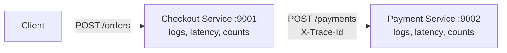

# Module 9 Assignment: Fault Tolerance & Observability

Checkout calls Payment for each order. Checkout creates a trace id and sends it to Payment in the `X-Trace-Id` header. Both services log that id with the request result, the latency, and the running success and failure counts.

Python 3.9 or newer is enough. There are no packages to install.

## Run both services

Open two terminals in this repository.

```bash
python3 payment_service.py
```

```bash
python3 checkout_service.py
```

| Service | Address | Role |
| --- | --- | --- |
| Checkout | http://127.0.0.1:9001 | Accepts orders and calls Payment |
| Payment | http://127.0.0.1:9002 | Approves the payment |

Checkout waits at most 1 second (`CHECKOUT_TIMEOUT`). Payment normally answers immediately. A delay is turned on with:

```bash
curl -sS -X POST http://127.0.0.1:9002/admin/delay \
  -H 'Content-Type: application/json' \
  -d '{"seconds": 3}'
```

Set `"seconds": 0` to remove it. `GET /metrics` on either service returns the success count, failure count, error rate, and last latency. `GET /health` shows that the process is still up.

## Architecture



The trace id is created once in Checkout and copied onto the Payment call. A log line from either service can be matched to the other by that id. Checkout's timeout is independent of Payment's delay, so a slow Payment call fails in Checkout without stopping either process.

## Example of a successful request

```bash
curl -sS -X POST http://127.0.0.1:9001/orders \
  -H 'Content-Type: application/json' \
  -d '{"order_id":"ord-1","amount":25}'
```

```text
HTTP 200
{"order_id": "ord-1", "status": "paid", "trace_id": "fb610fdd4c44", "payment_status": "approved", "latency_ms": 6.9}
```

Checkout log:

```text
[checkout] trace_id=fb610fdd4c44 event=request_start order_id=ord-1 amount=25 timeout_seconds=1.0
[checkout] trace_id=fb610fdd4c44 status=success latency_ms=6.9 success_count=1 failure_count=0 error_rate=0.00
```

Payment log for the same trace id:

```text
[payment] trace_id=fb610fdd4c44 event=request_start order_id=ord-1 amount=25 delay_seconds=0.0
[payment] trace_id=fb610fdd4c44 status=success latency_ms=0.1 success_count=1 failure_count=0 error_rate=0.00
```

Checkout metrics after this request:

```text
{"service": "checkout", "success_count": 1, "failure_count": 0, "request_count": 1, "error_rate": 0.0, "last_latency_ms": 6.9, "timeout_seconds": 1.0}
```

## Evidence of the timeout failure

Payment was delayed by 3 seconds, which is longer than Checkout's 1 second timeout.

```text
[payment] delay_seconds=3.0
```

```bash
curl -sS -X POST http://127.0.0.1:9001/orders \
  -H 'Content-Type: application/json' \
  -d '{"order_id":"ord-2","amount":40}'
```

Checkout returned in about 1.0 seconds:

```text
HTTP 504
{"error": "payment_timeout", "trace_id": "14651c498af4", "order_id": "ord-2", "message": "Payment did not respond before the checkout timeout. Checkout is still running."}
```

Checkout stayed up. `GET /health` still returned 200:

```text
{"status": "ok", "service": "checkout"}
```

The failed request is in the Checkout log, and the same trace id is in the Payment log:

```text
[checkout] trace_id=14651c498af4 event=request_start order_id=ord-2 amount=40 timeout_seconds=1.0
[checkout] trace_id=14651c498af4 status=failure latency_ms=1001.5 success_count=1 failure_count=1 error_rate=0.50
[checkout] trace_id=14651c498af4 event=timeout order_id=ord-2 error=timed out

[payment] trace_id=14651c498af4 event=request_start order_id=ord-2 amount=40 delay_seconds=3.0
[payment] trace_id=14651c498af4 status=success latency_ms=3004.4 success_count=2 failure_count=0 error_rate=0.00
```

The trace id `14651c498af4` connects the timeout in Checkout to the 3 second delay in Payment. Checkout's error rate rose from 0.00 to 0.50, and its last latency rose from 6.9 ms to 1001.5 ms.

```text
{"service": "checkout", "success_count": 1, "failure_count": 1, "request_count": 2, "error_rate": 0.5, "last_latency_ms": 1001.5, "timeout_seconds": 1.0}
```

## Evidence of recovery

The delay was removed:

```text
[payment] delay_seconds=0.0
```

The next order succeeded:

```text
HTTP 200
{"order_id": "ord-3", "status": "paid", "trace_id": "4e855b27a00a", "payment_status": "approved", "latency_ms": 1.1}
```

```text
[checkout] trace_id=4e855b27a00a event=request_start order_id=ord-3 amount=15 timeout_seconds=1.0
[checkout] trace_id=4e855b27a00a status=success latency_ms=1.1 success_count=2 failure_count=1 error_rate=0.33

[payment] trace_id=4e855b27a00a event=request_start order_id=ord-3 amount=15 delay_seconds=0.0
[payment] trace_id=4e855b27a00a status=success latency_ms=0.0 success_count=3 failure_count=0 error_rate=0.00
```

Checkout metrics after recovery:

```text
{"service": "checkout", "success_count": 2, "failure_count": 1, "request_count": 3, "error_rate": 0.33, "last_latency_ms": 1.1, "timeout_seconds": 1.0}
```

The error rate fell from 0.50 to 0.33 because the new request succeeded and the earlier failure stayed in the count. Last latency fell from 1001.5 ms back to 1.1 ms. Payment latency fell from 3004.4 ms to 0.0 ms.

## Reflection

Logs, traces, and metrics answer different questions about one failure. The Checkout log says this order failed because Payment timed out, and the shared trace id finds the Payment log that shows the 3 second delay on that same call. The metrics show the effect on the service: Checkout's error rate rose to 0.50 and its latency rose to the timeout, which is a different signal from a process crash because Checkout's health check still returned 200. After the delay was removed, a new request succeeded, the error rate dropped, and the latency returned to about 1 ms. The trace id ties those lines together, so the slow dependency can be distinguished from a bug inside Checkout.
